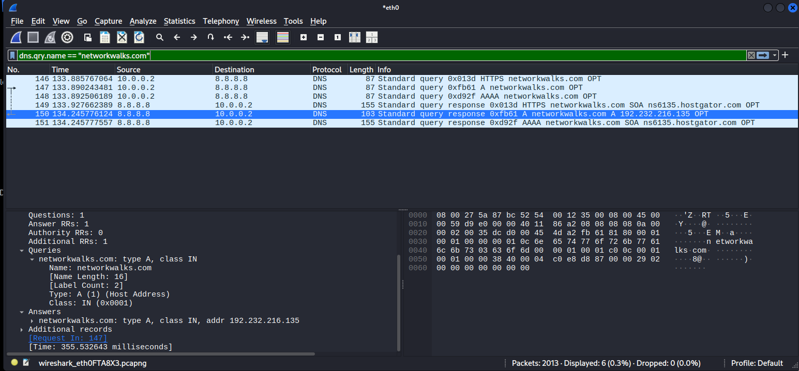

# NETWORKWALKS – WK1-PM4 (b): Wireshark Packet Capture

**Name:** Nnani Ifeanyi  
**Batch:** B084  
**Programme:** NETWORKWALKS Cybersecurity & Ethical Hacking Internship  

## Objective

Capture my own network traffic with Wireshark while opening **https://networkwalks.com**, then read the DNS and TLS details directly from the packets.

## Tools

- Wireshark
- Kali Linux VM (VirtualBox lab from Week 1), capture interface `eth0`
- Web browser

## Steps

1. Opened Wireshark and started a capture on the `eth0` interface.
2. Opened https://networkwalks.com in the browser and waited for the page to load fully.
3. Stopped the capture (2,013 packets captured).
4. Applied the display filter below to isolate the DNS traffic for the site:

   ```
   dns.qry.name == "networkwalks.com"
   ```

   The query packet shows the laptop (source) asking the DNS server (destination). The response packet contains the website IP under **Domain Name System (response) > Answers**.
5. Applied this filter to find the TLS Client Hello and read the server name (`Extension: server_name`) and the destination port:

   ```
   tls.handshake.type == 1
   ```
6. Applied this filter to find the Server Hello from the website and read the TLS version from the Protocol column:

   ```
   tls.handshake.type == 2
   ```

## Screenshot

DNS response for `networkwalks.com` showing the website IP in the Answers section:



## Answers

| # | Question | Answer |
|---|----------|--------|
| 1 | IP address of my laptop | `10.0.0.2` |
| 2 | IP address of my DNS server | `8.8.8.8` |
| 3 | IP address of networkwalks.com | `192.232.216.135` |
| 4 | Server Name sent in the TLS Client Hello | `networkwalks.com` |
| 5 | Server port for the secure connection | `443` |
| 6 | TLS version used by the website | `TLSv1.3` |

## What I learned

- Before a browser connects to a website, the machine sends a DNS query to resolve the name to an IP address (here the A record query went to 8.8.8.8).
- The TLS Client Hello carries the Server Name Indication (SNI) in clear text, so the site name is visible on the network even though the rest of the session is encrypted.
- HTTPS uses TCP port 443, and the Server Hello confirms the negotiated TLS version.
- Display filters such as `dns.qry.name` and `tls.handshake.type` make it quick to find the exact packets that matter in a large capture.
